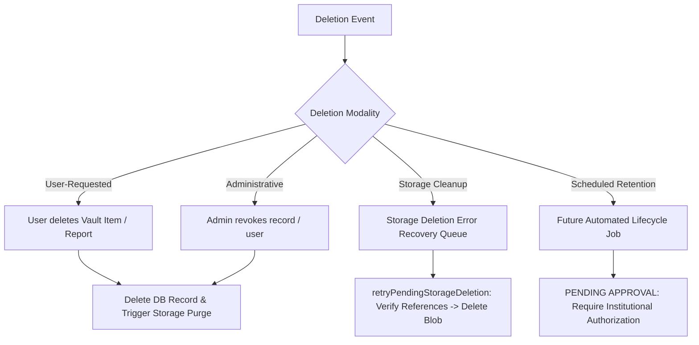

# HealthNex Data Retention & Deletion Policy

**Effective Date:** 23 October 2026  
**Document Version:** 1.0  
**Status:** Approved Internal Operational Policy  
**Security Reference:** `SEC-STOR-02`, `SEC-CRED-01`

---

## 1. Objective and Scope

This document establishes the operational data retention, archival, and deletion schedules for the HealthNex platform. It outlines the technical lifecycles across database records, binary storage objects, audit trails, and technical telemetry, ensuring compliance with the Digital Personal Data Protection Act, 2023 (DPDP Act, 2023) and standard information security hygiene.

---

## 2. Data Categories & Current Retention Schedules

| Data Category | Target Entity / Table | Description & Purpose | Approved Retention Policy | Operational Status |
| :--- | :--- | :--- | :--- | :--- |
| **User Account Credentials** | `users` | Name, email, salted bcrypt password hash, role assignments. | Retained for the lifetime of the active account. Deleted upon verified user account erasure request. | **Active / Implemented** |
| **User Profile & Demographics** | `users` | DOB, gender, blood group, medical history, location coordinates. | Retained for active user profile usage. Deleted upon user removal or account deletion. | **Active / Implemented** |
| **Approved Health Worker Credentials** | `users` (`verificationDocStorageId`) | Professional medical licenses, institutional ID cards. | Retained during active verified affiliation to support clinical auditing and authenticity verification. | **Active / Implemented** |
| **Rejected Health Worker Credentials** | `users` (`verificationDocStorageId`) | Credentials submitted by applicants whose verification was rejected by an administrator. | **Pending Institutional Decision:** Proposed retention window is 30 days from rejection timestamp to permit appeal review before deletion. | **PENDING APPROVAL (SEC-CRED-01)** |
| **Health Vault Records** | `healthData` | Self-reported vitals, symptoms, medications, water tests, and associated files. | Retained until user deletes the record or account. On record deletion, binary files are purged via reference-verified cleanup. | **Active / Implemented** |
| **Community Disease Reports** | `communityReports` | Outbreak summaries, coordinates, severity, categories, and photo attachments. | Retained for public health surveillance and epidemiological trend modeling. Deleted on reporter or admin request. | **Active / Implemented** |
| **Support Inquiries** | `supportTickets` | User inquiries, ticket messages, name, email. | Retained for 180 days following ticket resolution for customer support quality and reference. | **Active / Implemented** |
| **Immutable Audit Logs** | `auditLogs` | Role changes, verification status updates, security deletions, credential approvals. | Retained permanently in read-only form for regulatory compliance and non-repudiation auditing. | **Active / Implemented** |
| **Storage Deletion Queue** | `pendingStorageDeletions` | Recovery tracker for failed blob deletions. | Retained until retry deletion succeeds. Exhausted entries retained for manual administrative inspection. | **Active / Implemented (SEC-STOR-02)** |

---

## 3. Deletion Modalities & Technical Mechanisms

HealthNex recognizes four distinct deletion modalities:

### 1. User-Requested Deletion
- Users have direct self-service capability to delete their personal health data records (`deleteHealthData`) and community reports (`deleteReport`).
- The mutation verifies user ownership (`userId === record.userId`) or administrative privilege (`role === 'admin'`).

### 2. Administrative Deletion
- Authorized platform administrators may remove fraudulent community reports, duplicate disease data, or suspended accounts.
- Every administrative deletion generates an immutable record in `auditLogs` containing the administrator's ID, target record ID, timestamp, and action summary.

### 3. Storage Deletion Recovery Queue (`pendingStorageDeletions`)
- In Convex, database transactions and blob storage deletions are non-atomic.
- When `ctx.storage.delete(storageId)` encounters a network timeout, transient fault, or backend error, the failure is caught and recorded in `pendingStorageDeletions`.
- **Pre-Deletion Safety Verification:** Before any retry deletion is executed, `isStorageIdReferenced(ctx, storageId)` scans all collections (`communityReports`, `users`, `healthData`). If the file has been re-referenced, deletion is immediately aborted and marked `superseded_or_referenced`.
- **Error Sanitization:** Error strings written to the queue are stripped of raw URLs, bearer secrets, and authorization keys to prevent credential leakage.

### 4. Scheduled Retention Deletion (Approval Gate)
- Automatic background purging of data (such as expiring rejected health worker credentials) requires an explicit, documented institutional authorization.
- **Rule:** No automated scheduled deletion job may be introduced or activated without formal written approval from the Institutional Governance Committee / Legal Counsel.

---

## 4. Pending Institutional Decisions (`SEC-CRED-01`)

The following retention policy remains open and requires authorized institutional sign-off before implementation:

1. **Rejected Health Worker Credential Binary Retention (SEC-CRED-01)**:
   - **Candidate Rule:** Delete rejected credential binaries (`verificationDocStorageId`) after 30 days, measured from the administrative rejection timestamp.
   - **Current Status:** **Unapproved / Pending Institutional Decision**.
   - **Reason for Suspension:** Requires sign-off from the HealthNex Legal / Hospital Directorate to balance candidate appeal rights against data minimization principles under the DPDP Act, 2023.
   - **Safety Assurance:** The system currently retains rejected credentials in private storage until this decision is formally executed.

2. **Metadata Retention Upon Binary Deletion**:
   - Once a credential binary is purged, user verification metadata (such as applicant name, email, submission date, rejection reason notes, and audit log entries) will be permanently retained in the database for compliance and anti-fraud verification.

---

## 5. Exceptions: Legal Holds and Investigations

Automatic or routine data deletion must be immediately suspended under the following circumstances:

- **Formal Appeal Pending:** If a health worker applicant files a formal appeal regarding a rejected verification status.
- **Regulatory or Legal Inquiry:** Upon receipt of a valid notice or order from a court of competent jurisdiction, the Data Protection Board of India, or an authorized law enforcement agency.
- **Active Incident Investigation:** When records are relevant to an ongoing security incident, data breach investigation, or forensic audit.

---

## 6. Approvals and Review Cadence

This policy is subject to annual review by the HealthNex Technical Steering Committee and Data Protection Officer. Any changes to automated retention rules must undergo a security review before code deployment.
